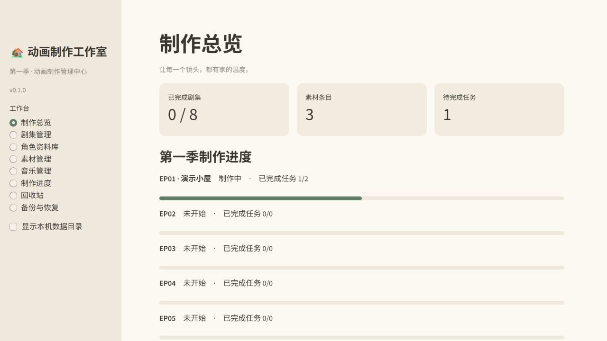

# AI Animation Studio · AI 动画制作管理中心

**v0.1.0 · MIT 开源协议**

一个简体中文、面向个人创作者的动画制作工作台。管理剧集、角色参考、分镜任务、音乐版本和素材，进度保存在本地 SQLite。采用 Python / Streamlit，CPU 即可运行，无需 GPU，也不需要 API Key。

本项目源于《The Claude Family》的制作管理需求。公开程序与原作制作资料完全分离：仓库不包含原作剧本、角色设计、配音、歌曲、成片或生产数据库。所有截图与演示数据均为合成示例，不代表原作内容；本项目不隶属于或代表 Anthropic。

## 界面预览

以下截图来自独立演示项目，不包含真实制作资料。



## v0.1.0 功能

- 制作总览：八集进度、待办、素材分类与音乐状态。
- 剧集与镜头：剧本历史、场景/镜头任务、模型或工具、修改意见与完成时间。
- 角色资料库：立绘、三视图、表情、服装参考，同一素材可被多集、多角色引用。
- 素材管理：图片、音频、视频预览，标签/场景搜索，分类与引用筛选。
- 版本管理：原文件追加保存、并排审阅、歌词差异与最终采用版本。
- 回收站：确认软删除、恢复、二次确认永久删除、重复内容和关联范围提示。
- 完整备份：数据库快照、历史文件、哈希校验；恢复为独立副本。

## 安装与运行

推荐 **Python 3.11**。依赖已锁定在 `requirements-lock.txt`；首次启动需要联网下载依赖。无注册、支付或云端模型调用。

### Windows（不熟悉编程也可用）

1. 下载源码 ZIP 并解压到一个固定文件夹；先安装 Python 3.11。
2. 双击 `start.bat`，等待依赖安装完成。
3. 浏览器打开 <http://127.0.0.1:8501>；若窗口打开过早，等待终端显示启动成功后刷新。
4. 停止时在终端按 Ctrl+C，下次继续双击启动。请勿删除数据目录。

### Linux / macOS

在源码目录打开终端：

```bash
python3 -m venv .venv
.venv/bin/python -m pip install -r requirements.txt
.venv/bin/python start.py --data-dir "$HOME/ai-animation-studio-data"
```

这里明确指定可写的个人目录。Notebook 推荐 `/mnt/workspace/ai-animation-studio-data`；不要在临时目录放生产素材。之后可运行 `bash start.sh`，启动器会记住先前选定的数据目录。

### 体验纯合成演示

安装依赖后，在项目目录执行（Windows 使用 `.venv\Scripts\python.exe` 代替下方解释器路径）：

```bash
.venv/bin/python demo.py
.venv/bin/python start.py --data-dir ./demo-data
```

生成器包含几何图形参考图、虚构短剧本、示例任务及一秒静音，不含任何真实角色、音乐或生成模型素材。目标目录非空时会拒绝执行，防止覆盖数据。`demo-data/` 被 Git 忽略。

## 数据放在哪里

| 情况 | 默认位置 |
| --- | --- |
| Windows | 当前项目的 `data/` |
| Linux 默认值（面向 Notebook） | `/mnt/workspace/ai-animation-studio-data` |
| 自定义 | `start.py --data-dir 完整路径`，保存到本机设置供重启使用 |

`TCF_DATA_DIR` 环境变量保留用于兼容原程序；本机 `local-settings.json` 的显式目录优先。所有本机设置、数据库、素材、备份均排除在 Git 之外。公开源码不附数据库。

从旧制作项目迁移时：先导出完整备份，再将备份恢复到独立目录验证。不要用演示数据覆盖旧目录。公开版本与旧工作室的数据及启动路径保持独立。

## ModelScope Notebook

1. 将源码放到 `/mnt/workspace/ai-animation-studio`。
2. 先执行 `python3 check_notebook.py` 检查持久目录和代理包，再确认平台是否提供受登录保护且支持 WebSocket 的端口预览入口。
3. 在源码目录运行 `bash start.sh --data-dir /mnt/workspace/ai-animation-studio-data`。
4. 容器内 `curl -f http://127.0.0.1:8501/_stcore/health` 应返回 `ok`，但这不代表外部可访问。
5. 使用平台实际提供的受保护预览地址。只有平台明确要求时才加 `--address 0.0.0.0`。若已启用 Jupyter Server Proxy，可按其实际前缀访问 `proxy/8501/`；不保证免费 Notebook 提供此路由。

不能将自己电脑的 `localhost` 当作 Notebook 地址。没有可用入口时使用本机版本，不自动建立公网隧道。已通过 GitHub Actions 的 Ubuntu/Windows 安装与测试；尚未在真实 ModelScope 实例验证端口访问；[官方 Notebook 文档](https://modelscope.cn/docs/notebook/intro)与账户当前界面为准。

## 日常使用与边界

在剧集/角色页填写资料，点击保存；素材上传时选择分类、角色和集数。旧文件不会被新版本覆盖。多个引用共享同一素材，整条删除会影响所有引用显示，弹窗会提前列出；仅取消某处引用请编辑“资料与关联”。

回收站软删除保留原文件和全部版本，恢复后重新显示原引用。永久删除需要再次确认，将清除所选素材的全部版本原文件，不删除其他素材或已有备份；保留元数据用于审计。文件占用导致未完成时可在回收站重试。

备份页可导出包含所有未永久清除文件的 ZIP，并下载到电脑。恢复只写新目录，校验通过后手动选择下次启动使用。大于 200 MB 的备份使用命令行：

```bash
.venv/bin/python backup.py export --data-dir /path/to/your-data
.venv/bin/python backup.py restore --archive /path/to/backup.zip --data-dir /path/to/your-data
```

上传单文件限 200 MB；免费 Notebook 建议使用较小的审阅视频。Office/PDF 下载后查看；MP4 建议 H.264/AAC，音频支持 MP3/WAV/M4A 等，实际播放取决于浏览器。音视频版本比较是并排审阅，不自动同步或评价质量。

应用无身份认证，适合个人本机或平台登录保护下使用；不要直接开放匿名公网端口。Notebook 休眠后需重启服务，存储回收政策由平台决定，重要文件请另存离线备份。

## 测试与源码

```bash
.venv/bin/python -m unittest discover -v
.venv/bin/python -m pip check
python scripts/audit_release.py
```

`app.py` 是页面；`store.py` 管理 SQLite 与原文件；`backup.py` 处理备份；`demo.py` 生成合成演示；`scripts/` 是发布检查工具。测试全部使用隔离目录。

参见 [测试报告](docs/TEST_RESULTS.md)、[发布审阅清单](docs/RELEASE_REVIEW.md)、[第三方许可证](docs/DEPENDENCIES.md)、[许可证建议](docs/LICENSE_DECISION.md)。

## 许可证与维护

本项目代码及自制合成演示采用 [MIT 许可证](LICENSE)。第三方依赖遵循其各自许可证；原作名称、角色、剧本、音乐与私人素材不随程序授权。

本次只准备 v0.1.0，不承诺后续功能计划；后续变更以实际使用需求为准。
